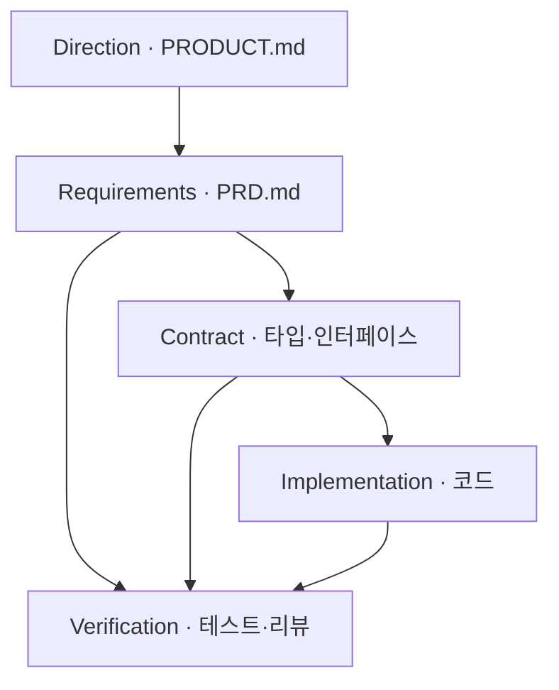
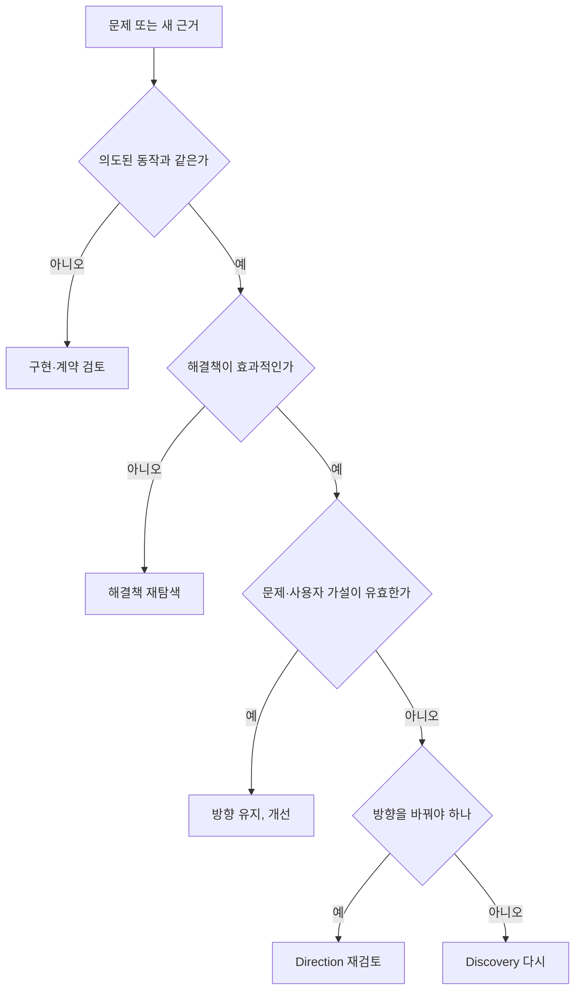

# 변경 전파

바뀐 의도의 기준 원본부터 고치고(Change at the Source), 실제로 영향받는 곳에만 전파하고(Propagate by Impact), 새 의도와 지킬 동작을 함께 검증한다(Verify Consistency).

## 계층

## 전파표

| 바뀐 원본 | PRODUCT.md | PRD | 디자인 | 계약 | 코드 | 테스트 |
|---|---|---|---|---|---|---|
| 방향 | 바꿈 | 검토 | 검토 | 검토 | 검토 | 검토 |
| 요구사항 | 유지 | 바꿈 | 검토 | 검토 | 검토 | 검토 |
| 계약 | 유지 | 검토 | 필요할 때 | 바꿈 | 검토 | 검토 |
| 내부 구현 | 유지 | 유지 | 유지 | 유지 | 바꿈 | 검토 |
| 검증 방식 | 유지 | 유지 | 유지 | 유지 | 유지 | 바꿈 |

- 기본 범위다. 실제 의존 관계로 조정한다.
- 요구사항이 그대로인 버그 수정·리팩터링은 PRD를 고치지 않는다.
- 검증 방식을 고치는 것은 기대 동작을 바꾸는 것이 아니다.
- 공개 API·저장 형식처럼 밖과의 약속이 바뀌면 호출자·구현체·테스트와 호환성을 함께 본다.

## 변경 원인 분기

- 근거가 부족하면 먼저 조사하거나 검증한다.
- 성과가 낮다는 사실만으로 방향을 바꾸지 않는다.
- 방향 변경은 대상 사용자·핵심 문제·가치가 틀렸다는 근거가 쌓였거나 기존 방향을 유지할 수 없는 제약이 확인됐을 때만 검토한다.

## 할 일

- 변경 목적과 영향 범위를 파악한다.
- 바뀌는 의도와 지킬 동작을 나눈다.
- 의도가 바뀌면 그 기준 원본을 먼저 고친다.
- 영향받는 계약·코드·테스트를 함께 고친다.
- 무관한 변경과 상충하는 현재 명세를 남기지 않는다.
- 중요한 결정 근거는 필요할 때만 남긴다. PRD나 커밋 메시지로 충분하면 결정 문서를 만들지 않는다.
- 위임 범위를 벗어나면 사람에게 묻는다.
