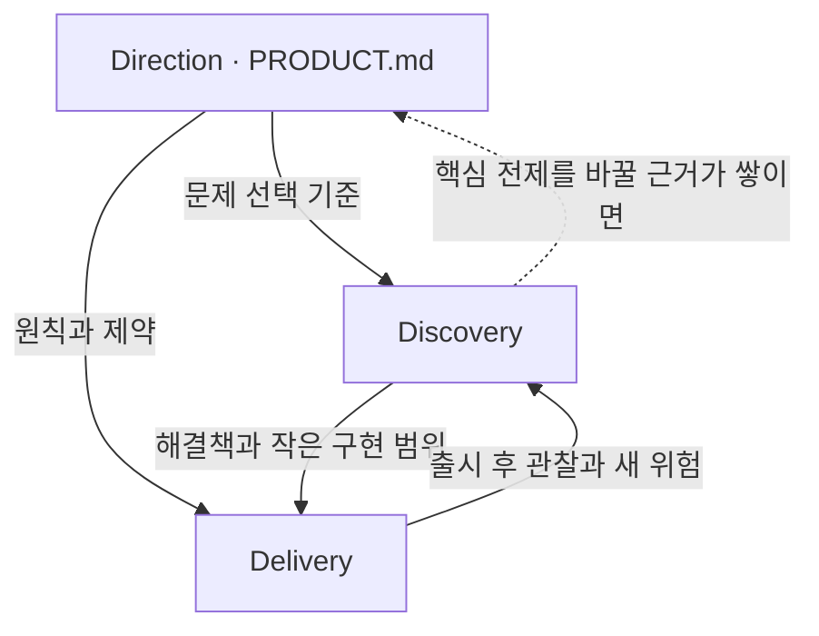
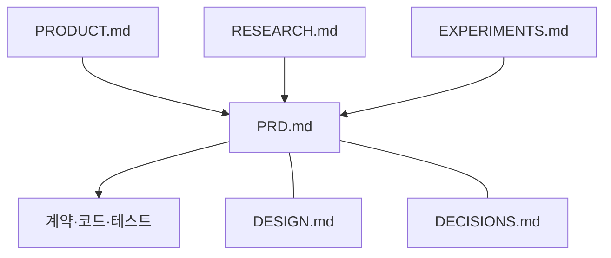

# Product D3 핵심

Direction(방향)·Discovery(탐색)·Delivery(구현·출시)를 잇는 제품 개발 흐름이다. 모든 `product-d3` 스킬이 이 문서를 기준으로 판단한다.

## 순환

- Direction은 매 기능마다 다시 정하지 않는다. 탐색과 구현 내내 판단 기준으로 쓴다.
- Discovery는 결정을 바꿀 가정을 가장 싼 방법으로 확인한다. 검증되지 않은 가정에 큰 제작 비용을 쓰지 않는다.
- Delivery는 계약과 테스트로 기대 동작을 정하고 구현한다. 출시 뒤 결과를 다음 Discovery에 넘긴다.
- 현재 기능을 구현하는 동안 다음 문제를 탐색해도 된다.

## 판단 원칙

- 제품 방향에 맞는 문제부터 고른다. 누구의 어떤 문제인지, 원칙에 맞는지, 비목표인지 먼저 본다.
- 관찰과 가설을 나눠 적는다. 불확실성이나 구현 비용이 클수록 더 작은 실험으로 핵심 가정부터 확인한다.
- 작게 구현하고 결과로 고친다. 다음 결정에 필요한 내용만 문서에 남긴다.
- 동작 규칙은 코드·계약·테스트에, 목적과 결정 근거는 문서에 둔다. 같은 규칙을 두 곳에 손으로 관리하지 않는다.

## 두 피드백 루프

| | Product Loop | Engineering Loop |
|---|---|---|
| 질문 | 만들 가치가 있었나 | 제대로 만들었나 |
| 기준 | 성과 조건(PRD의 Success Criteria) | 완료 조건(작업 정의, 계약, 테스트) |
| 확인 | 관찰·실험·지표·피드백 | 테스트·빌드·리뷰 |
| 주기 | 실험·출시 단위 | 코드 변경 단위 |

완료 조건을 다 채워도 가치는 입증되지 않는다. 두 루프의 결과는 서로를 대신하지 않는다.

## 정보별 기준 위치

| 정보 | 기준 위치 |
|---|---|
| 제품 목적·사용자·가치·원칙·비목표·성공 기준 | `PRODUCT.md` |
| 기능 목적·문제·요구사항·범위·성과 조건 | 기능별 `PRD.md` |
| 조사 근거·실험 결과·주요 결정 | PRD 또는 `RESEARCH.md`·`EXPERIMENTS.md`·`DECISIONS.md` |
| 책임·유효한 상태·도메인 규칙 | 타입·인터페이스·계약 |
| 실제 동작 | 구현 코드와 실행 결과 |
| 기대 동작·완료 조건 | 테스트와 리뷰 기준 |
| 화면의 시각적 설계 | 디자인 원본 또는 UI 코드 |
| AI 협업 규칙 | `AGENTS.md` |
| 설치·빌드·실행 | `README.md` 또는 실행 스크립트 |
| 지금 하는 작업 | 작업 정의(대화·세션 문서) |

- 모든 정보에 적용되는 단일 우선순위는 없다. 현재 코드를 곧 올바른 요구사항으로 보지 않는다.
- PRD와 테스트가 같은 동작을 요구하는데 실행 결과가 다르면 구현 결함을 먼저 의심한다.
- PRD와 테스트가 서로 다른 동작을 요구하면 결정 이력을 보고, 그래도 의도가 불명확하면 사람에게 묻는다.

## 문서 관계

관계도는 역할을 보여 줄 뿐이다. 모든 파일을 만들거나 순서대로 쓰지 않는다.

## 현재 명세와 역사적 기록

| 파일 | 관리 |
|---|---|
| `PRODUCT.md`, `PRD.md`, 계약, 테스트 | 현재 유효한 의도로 고쳐 쓴다. 상충하는 옛 요구사항을 남기지 않는다 |
| `RESEARCH.md`, `EXPERIMENTS.md` | 당시 관찰을 출처·시점과 함께 쌓는다. 과거 관찰을 현재 사실로 쓰지 않는다 |
| `DECISIONS.md` | 결정과 대체 관계를 쌓는다 |
| git | 무엇이 바뀌었나. 왜 바뀌었나는 결정 기록이나 PRD Rationale |
