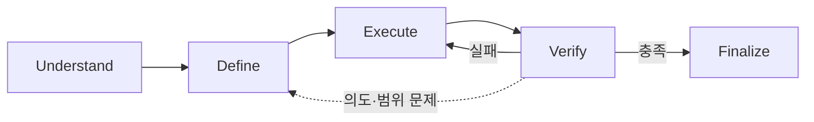

# 작업 생명주기와 유형

## 생명주기

| 단계 | 하는 일 |
|---|---|
| Understand | 의도·현황·맥락 확인 |
| Define | 범위·제약·완료 조건. 유지할 것과 바꿀 것 |
| Execute | 조사·실험·구현 |
| Verify | 결과 확인. 실패 원인 분류 |
| Finalize | 바뀐 의도의 기준 원본 갱신, 보고 |

간단한 작업은 한 요청으로 다섯 단계를 모두 지난다. 단계마다 승인을 받지 않는다.

## 유형

| 유형 | 요구사항 | 구현 | 완료 조건 | PRD |
|---|---|---|---|---|
| Feature | 추가 | 추가 | 새 기대 동작 충족 | 만들거나 고침 |
| Enhancement | 변경 | 변경 | 바뀐 기대 동작 충족 | 고침 |
| Bug Fix | 유지 | 수정 | 의도된 동작 복구, 회귀 테스트 | 의도가 불명확했을 때만 한 줄 보강 |
| Refactoring | 유지 | 내부 구조 변경 | 외부 동작 보존, 구조 개선 | 고치지 않음 |
| Experiment | 미확정 가설 | 선택 | 판단에 필요한 근거 확보. 가설이 틀렸다는 증거도 결과다 | `EXPERIMENTS.md`, 판정에 따라 PRD |

유형은 변경 목적이다. 한 요청에 두 유형이 섞이면(버그 수정 중 동작 개선 등) 작업을 나누거나, 큰 쪽 유형으로 보고 다른 쪽을 Define에 적는다.

## 작업 크기

다음 셋을 채우면 더 나누지 않는다.

- 명확성: 무엇을 바꾸는지 한 줄로 쓸 수 있다
- 독립성: 불필요한 변경 없이 할 수 있다
- 검증 가능성: 완료 여부를 확인할 수 있다

사용자 기능은 수직으로 나눈다: 기대 동작 하나를 UI·도메인·데이터까지 구현하고 검증한 뒤 다음으로 간다. 기반 기술 작업은 상황에 맞게 나눈다.

## 유형별 읽는 범위

| 정보 | Feature | Enhancement | Bug Fix | Refactoring | Experiment |
|---|---|---|---|---|---|
| `AGENTS.md` | 먼저 | 먼저 | 먼저 | 먼저 | 먼저 |
| `PRODUCT.md` | 먼저 | 먼저 | 필요할 때 | 필요할 때 | 먼저 |
| PRD | 먼저 | 먼저 | 필요할 때 | 필요할 때 | 먼저 |
| 디자인·조사 | 먼저 | 필요할 때 | 필요할 때 | 필요할 때 | 먼저 |
| 계약·코드·테스트 | 먼저 | 먼저 | 먼저 | 먼저 | 필요할 때 |
| 의존성·구조 | 필요할 때 | 필요할 때 | 필요할 때 | 먼저 | 필요할 때 |

안전·개인정보에 닿으면 버그 수정이라도 제품 의도를 확인한다.

## 읽는 순서

작업 정의 → `AGENTS.md` → `PRODUCT.md` → 관련 PRD → 계약·코드·테스트 → 필요한 의존성과 외부 자료. 모든 파일을 차례로 읽으라는 뜻이 아니다. 파일 이름, 코드 검색, 타입 참조, 호출 관계, PRD의 References로 찾고, 의존성이 드러나면 범위를 넓힌다. 읽는 범위를 넓혀도 바꿀 수 있는 범위는 그대로다.

## 일시적 정보와 지속적 정보

작업 중 생긴 계획·로그·중간 발견은 일시적이다. 다음 작업에도 필요할 때만 옮긴다.

| 남길 것 | 옮길 곳 |
|---|---|
| 의도 | `PRODUCT.md` 또는 PRD |
| 근거 | PRD Rationale 또는 결정 기록 |
| 동작 | 계약과 테스트 |
| 반복 절차 | 스킬 |

긴 작업을 다른 세션에 넘길 때만 진행 상태와 미해결 사항을 인수인계한다. 코드와 테스트로 드러난 사실은 다시 적지 않는다.
